# THIẾT KẾ CƠ SỞ DỮ LIỆU & ERD (ORACLE DATABASE 19c+)

## 1. Sơ đồ Thực thể Liên kết (ERD - Mermaid)

```mermaid
erDiagram
    USERS ||--o{ USER_ROLES : "has"
    ROLES ||--o{ USER_ROLES : "assigned_to"
    USERS |o--o| EMPLOYEES : "linked_account"

    BRANDS ||--o{ PRODUCTS : "produces"
    CATEGORIES ||--o{ PRODUCTS : "classifies"
    PRODUCTS ||--o{ PRODUCT_IMAGES : "has_images"
    PRODUCTS ||--o{ PRODUCT_VARIANTS : "has_variants"
    SIZES ||--o{ PRODUCT_VARIANTS : "sizes"
    COLORS ||--o{ PRODUCT_VARIANTS : "colors"

    SUPPLIERS ||--o{ PURCHASE_ORDERS : "supplies"
    EMPLOYEES ||--o{ PURCHASE_ORDERS : "creates"
    PURCHASE_ORDERS ||--|{ PURCHASE_ORDER_DETAILS : "contains"
    PRODUCT_VARIANTS ||--o{ PURCHASE_ORDER_DETAILS : "imported_as"

    CUSTOMERS ||--o{ SALES_ORDERS : "places"
    EMPLOYEES ||--o{ SALES_ORDERS : "handles"
    SALES_ORDERS ||--|{ SALES_ORDER_DETAILS : "contains"
    PRODUCT_VARIANTS ||--o{ SALES_ORDER_DETAILS : "sold_as"
    SALES_ORDERS ||--o{ PAYMENTS : "paid_by"
    SALES_ORDERS ||--|{ ORDER_STATUS_HISTORY : "tracks_status"

    ROLES {
        NUMBER(19) ID PK
        VARCHAR2(50) ROLE_CODE UK "ADMIN | MANAGER | STAFF"
        VARCHAR2(100) ROLE_NAME
        VARCHAR2(255) DESCRIPTION
        VARCHAR2(20) STATUS "ACTIVE | INACTIVE"
    }

    USERS {
        NUMBER(19) ID PK
        VARCHAR2(50) USERNAME UK
        VARCHAR2(255) PASSWORD_HASH
        VARCHAR2(100) FULL_NAME
        VARCHAR2(100) EMAIL UK
        VARCHAR2(20) PHONE
        VARCHAR2(20) STATUS "ACTIVE | INACTIVE | LOCKED"
        TIMESTAMP LAST_LOGIN_AT
    }

    USER_ROLES {
        NUMBER(19) ID PK
        NUMBER(19) USER_ID FK
        NUMBER(19) ROLE_ID FK
    }

    EMPLOYEES {
        NUMBER(19) ID PK
        VARCHAR2(30) EMPLOYEE_CODE UK
        VARCHAR2(100) FULL_NAME
        DATE DATE_OF_BIRTH
        VARCHAR2(20) GENDER
        VARCHAR2(20) PHONE UK
        VARCHAR2(100) EMAIL UK
        VARCHAR2(255) ADDRESS
        VARCHAR2(100) POSITION
        DATE HIRE_DATE
        NUMBER(19) USER_ID FK,UK
        VARCHAR2(20) STATUS "ACTIVE | INACTIVE"
    }

    CUSTOMERS {
        NUMBER(19) ID PK
        VARCHAR2(30) CUSTOMER_CODE UK
        VARCHAR2(100) FULL_NAME
        VARCHAR2(20) PHONE UK
        VARCHAR2(100) EMAIL
        VARCHAR2(20) GENDER
        DATE DATE_OF_BIRTH
        VARCHAR2(255) ADDRESS
        VARCHAR2(20) STATUS "ACTIVE | INACTIVE"
    }

    CATEGORIES {
        NUMBER(19) ID PK
        VARCHAR2(30) CATEGORY_CODE UK
        VARCHAR2(100) CATEGORY_NAME UK
        VARCHAR2(500) DESCRIPTION
        VARCHAR2(20) STATUS "ACTIVE | INACTIVE"
    }

    BRANDS {
        NUMBER(19) ID PK
        VARCHAR2(30) BRAND_CODE UK
        VARCHAR2(100) BRAND_NAME UK
        VARCHAR2(100) COUNTRY
        VARCHAR2(500) LOGO_URL
        VARCHAR2(500) DESCRIPTION
        VARCHAR2(20) STATUS "ACTIVE | INACTIVE"
    }

    SIZES {
        NUMBER(19) ID PK
        VARCHAR2(20) SIZE_VALUE UK
        NUMBER(5_1) SIZE_NUMBER
        VARCHAR2(255) DESCRIPTION
        VARCHAR2(20) STATUS "ACTIVE | INACTIVE"
    }

    COLORS {
        NUMBER(19) ID PK
        VARCHAR2(30) COLOR_CODE UK
        VARCHAR2(100) COLOR_NAME UK
        VARCHAR2(20) HEX_CODE
        VARCHAR2(20) STATUS "ACTIVE | INACTIVE"
    }

    PRODUCTS {
        NUMBER(19) ID PK
        VARCHAR2(30) PRODUCT_CODE UK
        VARCHAR2(200) PRODUCT_NAME
        NUMBER(19) BRAND_ID FK
        NUMBER(19) CATEGORY_ID FK
        VARCHAR2(150) MATERIAL
        VARCHAR2(1000) DESCRIPTION
        VARCHAR2(500) THUMBNAIL_URL
        NUMBER(18_2) IMPORT_PRICE
        NUMBER(18_2) SALE_PRICE
        VARCHAR2(20) STATUS "ACTIVE | INACTIVE"
    }

    PRODUCT_IMAGES {
        NUMBER(19) ID PK
        NUMBER(19) PRODUCT_ID FK
        VARCHAR2(500) IMAGE_URL
        NUMBER(1) IS_PRIMARY
        NUMBER(5) DISPLAY_ORDER
        VARCHAR2(20) STATUS "ACTIVE | INACTIVE"
    }

    PRODUCT_VARIANTS {
        NUMBER(19) ID PK
        NUMBER(19) PRODUCT_ID FK
        NUMBER(19) SIZE_ID FK
        NUMBER(19) COLOR_ID FK
        VARCHAR2(60) SKU UK
        NUMBER(18_2) IMPORT_PRICE
        NUMBER(18_2) SALE_PRICE
        NUMBER(10) AVAILABLE_QUANTITY
        VARCHAR2(20) STATUS "ACTIVE | INACTIVE"
    }

    SUPPLIERS {
        NUMBER(19) ID PK
        VARCHAR2(30) SUPPLIER_CODE UK
        VARCHAR2(200) SUPPLIER_NAME
        VARCHAR2(100) CONTACT_PERSON
        VARCHAR2(20) PHONE
        VARCHAR2(100) EMAIL
        VARCHAR2(255) ADDRESS
        VARCHAR2(50) TAX_CODE
        VARCHAR2(20) STATUS "ACTIVE | INACTIVE"
    }

    PURCHASE_ORDERS {
        NUMBER(19) ID PK
        VARCHAR2(30) PURCHASE_CODE UK
        NUMBER(19) SUPPLIER_ID FK
        NUMBER(19) EMPLOYEE_ID FK
        TIMESTAMP PURCHASE_DATE
        NUMBER(18_2) TOTAL_AMOUNT
        VARCHAR2(20) STATUS "DRAFT | CONFIRMED | CANCELLED"
        VARCHAR2(500) NOTE
    }

    PURCHASE_ORDER_DETAILS {
        NUMBER(19) ID PK
        NUMBER(19) PURCHASE_ORDER_ID FK
        NUMBER(19) PRODUCT_VARIANT_ID FK
        NUMBER(10) QUANTITY
        NUMBER(18_2) UNIT_PRICE
        NUMBER(18_2) SUBTOTAL
    }

    SALES_ORDERS {
        NUMBER(19) ID PK
        VARCHAR2(30) ORDER_CODE UK
        NUMBER(19) CUSTOMER_ID FK
        NUMBER(19) EMPLOYEE_ID FK
        TIMESTAMP ORDER_DATE
        NUMBER(18_2) TOTAL_AMOUNT
        NUMBER(18_2) FINAL_AMOUNT
        VARCHAR2(30) PAYMENT_METHOD "CASH | BANK_TRANSFER"
        VARCHAR2(20) STATUS "DRAFT | CONFIRMED | COMPLETED | CANCELLED"
        VARCHAR2(500) NOTE
    }

    SALES_ORDER_DETAILS {
        NUMBER(19) ID PK
        NUMBER(19) SALES_ORDER_ID FK
        NUMBER(19) PRODUCT_VARIANT_ID FK
        NUMBER(10) QUANTITY
        NUMBER(18_2) UNIT_PRICE
        NUMBER(18_2) SUBTOTAL
    }

    PAYMENTS {
        NUMBER(19) ID PK
        VARCHAR2(30) PAYMENT_CODE UK
        NUMBER(19) SALES_ORDER_ID FK
        VARCHAR2(30) PAYMENT_METHOD "CASH | BANK_TRANSFER"
        NUMBER(18_2) AMOUNT
        TIMESTAMP PAYMENT_DATE
        VARCHAR2(20) STATUS "PENDING | PAID | REFUNDED | CANCELLED"
        VARCHAR2(255) REFERENCE_NOTE
    }

    ORDER_STATUS_HISTORY {
        NUMBER(19) ID PK
        NUMBER(19) SALES_ORDER_ID FK
        VARCHAR2(20) FROM_STATUS
        VARCHAR2(20) TO_STATUS
        VARCHAR2(500) NOTE
        TIMESTAMP CHANGED_AT
    }
```

## 2. Nguyên tắc Chuẩn hóa & Ràng buộc
1. **Audit Columns**: Tất cả 19 bảng đều có `CREATED_AT`, `UPDATED_AT`, `CREATED_BY`, `UPDATED_BY`.
2. **Primary Key & Sequence**: Mỗi bảng sử dụng một Sequence riêng biệt (`SEQ_<TABLE_NAME>`) tăng tự động bắt đầu từ 1.
3. **Foreign Key & Toàn vẹn dữ liệu**: Không sử dụng `ON DELETE CASCADE` cho các bảng giao dịch (`PURCHASE_ORDERS`, `SALES_ORDERS`, `PAYMENTS`, `ORDER_STATUS_HISTORY`) để đảm bảo không bao giờ xóa cứng dữ liệu giao dịch đã phát sinh.
4. **Lưu giá lịch sử**:
   - `PURCHASE_ORDER_DETAILS.UNIT_PRICE` lưu đơn giá nhập thực tế tại thời điểm tạo phiếu nhập.
   - `SALES_ORDER_DETAILS.UNIT_PRICE` lưu đơn giá bán thực tế tại thời điểm tạo đơn hàng.
5. **Không có bảng Tồn kho độc lập & Khuyến mãi**:
   - Tuân thủ tuyệt đối yêu cầu đề bài: Không tạo bảng kho hay bảng mã giảm giá. `PRODUCT_VARIANTS.AVAILABLE_QUANTITY` chỉ phục vụ kiểm tra nhanh số lượng sẵn có khi bán tại quầy (POS) và tự động cập nhật khi phiếu nhập được xác nhận (`CONFIRMED`) hoặc đơn hàng bán được tạo/hủy.

